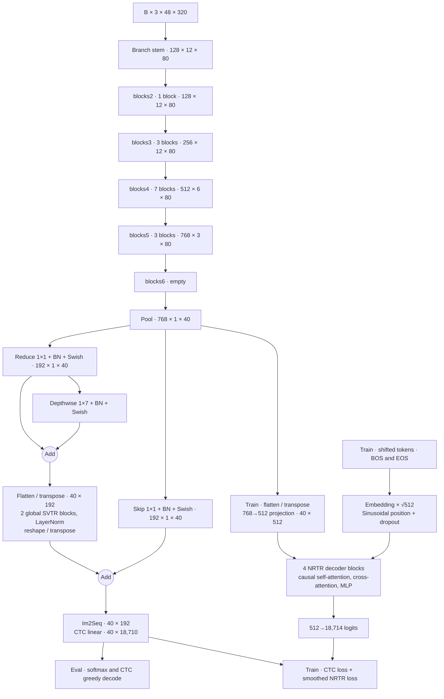

# PP-OCRv6 medium recognition source audit

The reference is PaddleOCR commit `dab3fe35379033fdcb2d0e9572fac0b36c9a9ebf`, using `configs/rec/PP-OCRv6/PP-OCRv6_medium_rec.yml` and the training-form checkpoint. The [technical report](https://arxiv.org/html/2606.13108v1) describes LCNetV4 in §2.1, LightSVTR and CTC+NRTR in §2.3, language coverage in Appendix A, and recognition ablations in Appendix C.3. The published 83.2% weighted recognition accuracy comes from an in-house benchmark.

## Execution graph

`build_model` constructs `BaseModel`. It creates `backbone=PPLCNetV4(det=False, model_size=medium)` and `head=MultiHead`, with neither a rectification transform nor a top-level neck. The CTC sequence encoder is owned by the head. `MultiHead.encoder_reshape` is instantiated and unused. The model dispatches `head(x, targets=data)`. Training supplies `batch[1:]` and returns `ctc`, `ctc_neck`, and `gtc`. Evaluation returns the CTC softmax directly. The common builder and vocabulary setup are in `tools/{train,eval,infer_rec}.py`, `tools/program.py`, and `ppocr/modeling/architectures/{__init__,base_model}.py`. `ppocr/utils/save_load.py::load_model` routes a pretrained path to `load_pretrained_params`, which warns about unknown or mismatched tensors and casts matched weights to the model dtype. The reference runner must check completeness independently.

## Backbone

Shapes below omit batch. Convolutions use NCHW and dilation 1. The stem is `backbone.conv1` (`StemBlock`). Its five `ConvBNAct` children each own a bias-free convolution, BN, and ReLU.

| Child | Operation | Output | Parameters |
|---|---|---|---:|
| stem1 | 3→64, 3×3 stride 2 pad 1 | 64×24×160 | 1,856 |
| pool | 2×2 max, stride 1, SAME | 64×24×160 | 0 |
| stem2a | 64→32, 2×2 stride 1 SAME | 32×24×160 | 8,256 |
| stem2b | 32→64, 2×2 stride 1 SAME | 64×24×160 | 8,320 |
| concat | pool first, stem2b second, axis 1 | 128×24×160 | 0 |
| stem3 | 128→64, 3×3 stride 2 pad 1 | 64×12×80 | 73,856 |
| stem4 | 64→128, 1×1 stride 1 pad 0 | 128×12×80 | 8,448 |

Each stage is a sequential list of `LCNetV4Block`. `token_mixer.rep_dw` applies `BN(DW3×3→BN(x) + DW1×1(x) + x)` at unit stride and constant channels, where the first term means convolution followed by its own BN. The stride/channel-changing blocks use `token_mixer.dw_conv`, a bias-free 3×3 depthwise convolution (pad 1) followed by BN. Optional `token_mixer.se` performs spatial mean → biased 1×1 (`C→C/4`) → ReLU → biased 1×1 (`C/4→C`) → HardSigmoid → channelwise multiplication. `channel_mixer` owns `expand` (bias-free 1×1 + BN, `C→2C`), `act` (GELU), and `compress` (bias-free 1×1 + BN, `2C→Cout`). With a residual, the mixer adds the token-mixed tensor and the final BN gamma starts at zero. Other Conv2D_BN gammas start at one and betas at zero. There is no stochastic depth in LCNetV4.

| Stage / block | Channels | DW stride | SE | Residual | Output | Parameters |
|---|---|---|---|---|---|---:|
| blocks2.0 | 128→128 | 1 | yes | yes | 128×12×80 | 76,448 |
| blocks3.0 | 128→256 | 1 | no | no | 256×12×80 | 100,736 |
| blocks3.1 | 256→256 | 1 | no | yes | 256×12×80 | 267,264 |
| blocks3.2 | 256→256 | 1 | yes | yes | 256×12×80 | 300,352 |
| blocks4.0 | 256→512 | (2,1) | no | no | 512×6×80 | 398,080 |
| blocks4.1/.3/.5 | 512→512 | 1 | yes | yes | 512×6×80 | 1,190,528 each |
| blocks4.2/.4/.6 | 512→512 | 1 | no | yes | 512×6×80 | 1,058,816 each |
| blocks5.0 | 512→768 | (2,1) | no | no | 768×3×80 | 1,319,936 |
| blocks5.1 | 768→768 | 1 | yes | yes | 768×3×80 | 2,670,528 |
| blocks5.2 | 768→768 | 1 | no | yes | 768×3×80 | 2,374,656 |
| blocks6 | identity | — | — | — | 768×3×80 | 0 |

Training applies adaptive average pooling to `(1,40)`. Evaluation uses ordinary average pooling with kernel and default stride `(3,2)` and requires feature height ≥3. The two agree at the nominal shape. The unfused graph keeps its branches in `eval()`. Explicit `rep()` folds each eligible BN into its convolution. RepDWConv folds the inner BN, adds centered DW1×1 and identity kernels, and then folds the outer BN. The stem and channel mixer fuse their convolution/BN pairs. SE and LightSVTR remain separate. Source: [rec_lcnetv4.py](https://github.com/PaddlePaddle/PaddleOCR/blob/dab3fe35379033fdcb2d0e9572fac0b36c9a9ebf/ppocr/modeling/backbones/rec_lcnetv4.py).

## LightSVTR and CTC

| Path under head | Operation | Nominal output | Parameters |
|---|---|---|---:|
| ctc_encoder.encoder.conv_reduce | 768→192, bias-free 1×1, BN, Swish | 192×1×40 | 147,840 |
| ctc_encoder.encoder.local_conv | bias-free DW 1×7, pad (0,3), BN, Swish | 192×1×40 | 1,728 |
| ctc_encoder.encoder.svtr_block.0/.1 | global attention and MLP | 40×192 | 444,864 each |
| ctc_encoder.encoder.norm | final LayerNorm, epsilon 1e-6 | 40×192 | 384 |
| ctc_encoder.encoder.skip_conv | 768→192, bias-free 1×1, BN, Swish | 192×1×40 | 147,840 |
| ctc_encoder.encoder_reshape | squeeze height, transpose B,C,W → B,W,C | 40×192 | 0 |
| ctc_head.fc | biased linear, 192→18,710 | 40×18,710 | 3,611,030 |

The local result is added to the reduced tensor. Flattening spatial dimensions and transposing makes 40 tokens. Each `rec_svtrnet.Block` executes `x += mixer(norm1(x))`, followed by `x += mlp(norm2(x))`, because upstream's `prenorm=False` branch uses pre-normalization in practice. Both block LayerNorms use epsilon 1e-5. The attention mixer owns biased `qkv` (192→576), `attn_drop`, biased `proj` (192→192), and `proj_drop`. Q/K/V each have eight 24-wide heads. Q is scaled before QKᵀ. Softmax is on the key axis, with no mask. The MLP owns biased `fc1` (192→768), Swish, biased `fc2` (768→192), and dropout called after activation and after fc2. Attention, output projection and MLP use p=0.1 in training. `drop_path` is Identity. After final normalization, restore NCHW and add the skip projection. `use_guide=false` allows gradients to reach the backbone. LightSVTR uses Kaiming uniform for pointwise weights, Kaiming normal for the local kernel, truncated normal (std 0.02) for linears, zero linear biases, and unit/zero LayerNorm affine initialization.

CTC has no extra guide convolution or intermediate FC. The projection initializes weight and bias uniformly in ±1/√192 with parameter-specific L2 factor 1e-5. Softmax is over class axis 2 only in evaluation. The vocabulary is 18,708 dictionary lines in file order, an appended space and a prepended blank (index 0). The space index is 18,709. Sources: [rnn.py](https://github.com/PaddlePaddle/PaddleOCR/blob/dab3fe35379033fdcb2d0e9572fac0b36c9a9ebf/ppocr/modeling/necks/rnn.py), [rec_svtrnet.py](https://github.com/PaddlePaddle/PaddleOCR/blob/dab3fe35379033fdcb2d0e9572fac0b36c9a9ebf/ppocr/modeling/backbones/rec_svtrnet.py).

## NRTR

`head.before_gtc` owns `Flatten(2)` and `FCTranspose`, transposing to `[B,40,768]` and applying a bias-free 768→512 linear (393,216 weights). This uses the pooled backbone output directly. `head.gtc_head` is `Transformer` with no encoder and four decoder layers. `embedding.embedding` holds `[18714,512]` (9,581,568 weights), padding index 0, initialized with NumPy normal std `512**-0.5`. Embeddings are scaled by √512. `positional_encoding` adds sinusoidal values from a `[5000,1,512]` buffer and applies 0.1 dropout. There is no positional layer on the memory.

With maximum encoded length L, take the first L+2 target tokens, then remove the last column for teacher forcing. All decoder activations are `[B,L+1,512]` except attention weights and the MLP expansion. Each `decoder.{0,1,2,3}` has:

| Child | Operation | Parameters per block |
|---|---|---:|
| self_attn | biased qkv 512→1536 and out_proj 512→512 | 1,050,624 |
| cross_attn | biased q 512→512, kv 512→1024, out_proj 512→512 | 1,050,624 |
| mlp | biased 512→2048, ReLU, biased 2048→512 | 2,099,712 |
| norm1/norm2/norm3 | each LayerNorm over 512, epsilon 1e-5 | 3,072 |
| dropout1/dropout2/dropout3 | p=0.1 on each residual branch | 0 |

Both attentions use 16 heads of width 32, scaling QKᵀ by `32**-0.5` after matmul. Self-attention adds a square float32 mask with −∞ strictly above the diagonal and zero elsewhere. There is no padding or cross-attention mask in this call path. Softmax is over keys and attention dropout is zero. Residual additions precede normalization in all three sublayers. The MLP has two internal p=0.1 dropout calls in addition to the third residual dropout. `tgt_word_prj` is a bias-free 512→18,714 linear (9,581,568 weights). Transformer linears are initialized by its Xavier-normal pass with zero bias. The extra NumPy initialization of the projection precedes that pass. The auxiliary decoder's standalone greedy path starts at BOS and stops early when every sample selects EOS. `MultiHead.eval()` bypasses it.

NRTR label indices are pad/blank 0, unknown 1, BOS 2 and EOS 3. Dictionary entries start at 4, with space at 18,712. The constructor receives 18,713 and adds one class for a total of 18,714, so index 18,713 is outside the training encoder's vocabulary. Sources: [rec_multi_head.py](https://github.com/PaddlePaddle/PaddleOCR/blob/dab3fe35379033fdcb2d0e9572fac0b36c9a9ebf/ppocr/modeling/heads/rec_multi_head.py), [rec_nrtr_head.py](https://github.com/PaddlePaddle/PaddleOCR/blob/dab3fe35379033fdcb2d0e9572fac0b36c9a9ebf/ppocr/modeling/heads/rec_nrtr_head.py).

## Parameter totals

The counts derived from source tensor dimensions match the downloaded training checkpoint. It contains 441 FP32 tensors with 58,150,582 scalar values. Of these, 55,527,798 are trainable weights and biases, 2,560,000 are sinusoidal position values, and 62,784 are BatchNorm running statistics. The training checkpoint's SHA-256 is `c4a110423c23739f157ff870e27f41649d8c89e4c8df5230c2cd2e9fd90a7e92`.

The [verified reference run](paddle_reference.md) records the hierarchy, class names, direct parameter shapes and recursive totals for 418 modules, along with observed input and output dimensions for every executed tensor-producing sublayer. Functional pooling, additions, transposes, and attention internals are covered by the execution graph and specifications above.

| Module | Trainable scalars |
|---|---:|
| Backbone | 14,356,768 |
| LightSVTR | 1,187,520 |
| CTC projection | 3,611,030 |
| NRTR preprojection | 393,216 |
| NRTR transformer | 35,979,264 |
| Full training graph | 55,527,798 |
| Unfused CTC inference path | 19,155,318 |
| CTC inference path with backbone `rep()` | 19,114,006 |

## Data, loss and decoding

- The eval YAML uses `DecodeImage(BGR, channel_first=false)` → `MultiLabelEncode(NRTRLabelEncode)` → `RecResizeImg` → `KeepKeys`. OpenCV decodes bytes to BGR, and its bilinear resize maps to height 48 with width `min(320, ceil(48*w/h))`. It then casts to float32, transposes HWC→CHW, divides by 255, subtracts 0.5, divides by 0.5, and right-pads with zeros in normalized space. Valid ratio is resized width / padded width, capped at one.
- `tools/infer_rec.py` removes the label operator, keeps only the image and sets infer mode. With a dictionary, `RecResizeImg` calls `resize_norm_img_chinese`. This raises canvas width to `int(48*max(320/48,w/h))`; a wide input can therefore exceed 320. The stock training and inference preprocessing paths must be captured with their respective modes.
- `MultiScaleDataSet` in `simple_dataset.py` runs its own resize/normalization at sampler heights 32, 48 and 64 and width 320. Training loads BGR, optionally concatenates up to two external images (p=0.5), applies recognition augmentation, and encodes labels before keeping image, CTC labels, NRTR labels, length, and valid ratio.
- Labels are iterated as Python characters in original case and order. Unknown characters are skipped. CTC pads to 25 with blank index 0 and saves true length. NRTR rejects encoded lengths ≥24, inserts BOS/EOS, and right-pads to 25.
- `MultiLoss` sums two equally weighted losses. `CTCLoss` transposes raw logits to T,B,C, passes full timestep counts for every example and the encoded label lengths to Paddle's CTC kernel (blank=0, reduction=none), then takes the arithmetic batch mean. Valid ratio is unused. `NRTRLoss` slices targets from column 1 through L+1 inclusive, flattens, applies class-axis log-softmax and smoothing (0.9 at the target, 0.1/(C−1) everywhere else), removes positions with target 0 and means the remaining token losses.
- `CTCLabelDecode` argmaxes and takes maxima along the class axis. It removes adjacent repeated indices before dropping blanks, concatenates the retained dictionary strings, and means their maxima. An empty result scores 0. There is no valid-ratio truncation or Unicode normalization.

## Paper and source distinctions

- Paper §2.1 describes token mixing with a residual outside its DW/SE expression. The source's same-shape block puts the identity in the RepDWConv sum before outer BN and optional SE, and its separate channel residual adds the already mixed tensor. Transition blocks have no identity. The source executes the branch ordering in the backbone table.
- The recognition backbone's final evaluation pool also downsamples width by two. Paper §2.1.2 describes average pooling along height after the width-preserving stage transitions. The actual nominal width after the last stage is 80 and after pooling it is 40.
- The paper compares deployed recognition sizes and describes NRTR as training-time guidance. The full checkpoint includes the auxiliary decoder and an unfused backbone, so its parameter total uses a different graph. The CTC branch uses LightSVTR and NRTR reads a separate linear projection of pooled backbone features.
- The paper's local-global neck description agrees with the configured 1×7 local convolution and global attention. Equation 4 omits the residual around the local convolution, the convolutional BN/Swish, and the final LayerNorm. The source also defines the actual pre-normalization order in `Block.forward`, whose flag name alone would imply the opposite.

## Published inference export

The official deployment archive (SHA-256 `4eecc1c6a4623765042e6fc15446da0da110b7d875b6b72b2d351d2b2dbd4da6`) contains a Paddle PIR graph, a 76,465,087-byte parameter file, and an inference YAML. Its YAML embeds the same 18,708 dictionary strings in the same order as the Git checkout. The HPI profile lists height 48, widths 160/320/3200 and batch sizes 1–8. The capture runner uses the training checkpoint and upstream dynamic graph to expose the unfused layer boundaries and auxiliary head. [Official inference archive](https://paddle-model-ecology.bj.bcebos.com/paddlex/official_inference_model/paddle3.0.0/PP-OCRv6_medium_rec_infer.tar).

## Operators to check during translation

Paddle 3.2.0 BatchNorm2D defaults to epsilon 1e-5 and momentum 0.9 on the old running statistics. Its buffers are `_mean` and `_variance`, initialized at zero and one. Compare the variance estimator and gradients on each backend. Test even-kernel SAME alignment and max-pool border handling. GELU defaults to the exact form, HardSigmoid is `clip(x/6 + 0.5, 0, 1)`, and Swish is `x * sigmoid(x)`. Preserve convolution grouping and adaptive/ordinary pooling differences. Linear weights are stored in input-by-output order. Preserve flattening and Paddle's reshape copy dimensions, exact attention scaling order, LayerNorm epsilon, mask polarity and dropout placements. Keep Paddle CTC's raw-logit contract, lengths, class axis and reduction distinct from the port's API inputs. Verify NRTR padding-embedding forward and gradient behavior, smoothing denominator and token count. Audit Paddle Adam/L2, the 5-epoch cosine warmup, the stem BN zero-decay overrides, and the CTC projection's own decay independently of the global 3e-5 factor.
